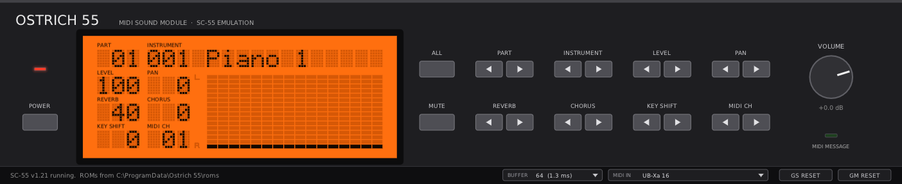

# Ostrich 55 (O-55)

An emulation of the **Roland SC-55 Sound Canvas** (1991) as a VST3/CLAP plugin and a
standalone program. A non-commercial fan project, the sister of
[Ostrich 220](https://github.com/Helge666/ostrich220).

The emulation is **[Nuked-SC55](https://github.com/nukeykt/Nuked-SC55)** by nukeykt, in
[J.C. Moyer's fork](https://github.com/jcmoyer/Nuked-SC55) (see [Origin and
thanks](#origin-and-thanks)): it runs the SC-55's **original firmware** on emulated CPUs and
an emulated PCM chip. Everything the firmware does comes along by itself: the sounds, GS
and GM, the effects, the display. Ostrich 55 adds the plugin around it: VST3, CLAP and a
standalone program, a panel after the unit, and a ROM setup that finds the images by their
contents.

You need your own ROM images. **This repository contains no Roland data and never will.**

## What it does

- **The SC-55 (mk1) itself**, firmware v1.00, 1.10, 1.20, 1.21 or 2.00: 16 parts, GS and
  GM, reverb and chorus, as the firmware makes them.
- **The panel:** the LCD as the unit's (PART, INSTRUMENT, LEVEL, PAN, REVERB, CHORUS,
  KEY SHIFT, MIDI CH and the 16 × 16 dot bar display), the key pairs, ALL and MUTE,
  POWER, VOLUME and the MIDI MESSAGE lamp. Drawn after the unit, not a copy of it.
- **GS RESET and GM RESET** in the bar under the panel.
- **MIDI timing:** every event reaches the emulated MIDI IN at its place in the host's
  block; the firmware reads it byte by byte from its serial port, as on the unit.
- The core runs at 64 kHz (Nuked-SC55's oversampling, on by default); a windowed-sinc
  resampler brings it to the host's rate.

Formats: VST3, CLAP and a standalone program on Windows (64-bit); VST3, CLAP and a JACK
standalone on Linux. No macOS build.

## Installing (Windows)

**[Download Ostrich 55](https://github.com/Helge666/ostrich55/releases/latest)** (Windows
and Linux zips; an installer will follow), or build it from source
([BUILDING.md](BUILDING.md)).

1. Copy `Ostrich55.vst3` to `C:\Program Files\Common Files\VST3\` (or
   `%LOCALAPPDATA%\Programs\Common\VST3\`), or `Ostrich55.clap` to the CLAP folder.
2. Load Ostrich 55 in your DAW (or start `Ostrich55.exe`). The first time, it asks
   for the ROM images: click **CHOOSE FILE** and pick any one of your SC-55 ROM images, or
   a zip with them. Ostrich 55 finds the others in the same folder by their contents,
   whatever their names, copies them to `C:\ProgramData\Ostrich 55\roms\` and starts.
   Which images you need: [roms/README.md](roms/README.md).

You can also copy the images to `C:\ProgramData\Ostrich 55\roms\` yourself. The status
line under the panel says which set runs and where it came from, or what is missing.
Folders searched, in this order: `%OSTRICH55_ROMS%`, `%PROGRAMDATA%\Ostrich 55\roms`,
`%LOCALAPPDATA%\Ostrich 55\roms`, `Documents\Ostrich 55\roms`; on Linux
`$OSTRICH55_ROMS`, `$XDG_DATA_HOME/Ostrich 55/roms`, `~/.local/share/Ostrich 55/roms`,
`/usr/share/Ostrich 55/roms`. With several versions there, v1.21 is played first.

## Playing it

- The keys of the panel work as the unit's; a key held down is held on the unit, so its
  firmware repeats as the unit does.
- **Mouse wheel** over a field of the display (PART, INSTRUMENT, LEVEL, ...): its ◀ ▶ keys.
  Over VOLUME: the volume.
- **Computer keyboard** (click into the panel first): ← → PART, ↑ ↓ INSTRUMENT.
- **MIDI IN** (the Windows standalone): the field in the bar under the panel picks the MIDI
  input, one port, all of them or none; the list is read again each time it opens, so a
  keyboard plugged in later shows up. The first start listens to all inputs; the choice is
  kept in `%LOCALAPPDATA%\Ostrich 55\standalone-midi-in.txt`. A port another program
  holds cannot be opened; the field says so. Each message is placed in the audio by the
  time it came in, so the delay from key to sound is steady rather than jittery. In a DAW
  the plugin gets its MIDI from the track, as any instrument.
- **BUFFER** (the standalone without JACK): the audio block size, 64 to 1024 frames;
  smaller is faster to respond and costs more CPU. Kept in
  `%LOCALAPPDATA%\Ostrich 55\standalone-buffer.txt`.

## Known limitations

- **No SysEx into the VST3** yet: DPF's VST3 wrapper does not take SysEx input, so GS
  setup messages from a DAW track do not reach it (GS RESET and GM RESET on the panel do).
  The CLAP and the standalone take SysEx. See [ROADMAP.md](ROADMAP.md).
- Only the SC-55 (mk1) so far; Nuked-SC55 also knows the SC-55mk2, SC-55st, CM-300/SCC-1,
  SC-155 and others (ROADMAP.md).
- The SC-55 forgets its panel settings at power-off, and so does Ostrich 55: a session
  restores what its MIDI sets, not what was set on the panel.
- The Windows standalone plays on Windows' default audio device, in WASAPI shared mode;
  there is no choice of device, no ASIO and no exclusive mode (DPF's standalone has none).
  Expect a few tens of milliseconds from key to sound; the VST3 or CLAP in a DAW with ASIO
  is faster.
- **Tested:** the VST3 in a DAW on Windows, the Windows standalone with a USB keyboard
  (MIDI IN, BUFFER), the CLAP headless on Linux (`ostrich_clap_render`). Not yet: the CLAP
  in a DAW, the Linux builds in use.

## Building

[BUILDING.md](BUILDING.md). What is planned: [ROADMAP.md](ROADMAP.md).

## Origin and thanks

The emulation is entirely **Nuked-SC55**, and all credit for it goes to its authors:

- **nukeykt** (Copyright © 2021, 2024): the reverse engineering of the SC-55 and the
  emulator, [nukeykt/Nuked-SC55](https://github.com/nukeykt/Nuked-SC55).
- **J.C. Moyer** (Copyright © 2024–2026): the fork Ostrich 55 builds on,
  [jcmoyer/Nuked-SC55](https://github.com/jcmoyer/Nuked-SC55), which turned the emulator
  into a library, recognises the ROMs by their hashes, adds tests and makes it faster.
- And, as Nuked-SC55's README thanks them: John McMaster (SC-55 PCM chip decap),
  org/ogamespec (deroute tool), the SDL team, Wohlstand (Linux/macOS port), mattw,
  HardWareMan, giulioz (JV-880 support), Cloudschatze, NikitaLita, Karmeck, Falcosoft, and
  Michael Mouton (ROM hashes and tests; Ostrich 55 recognises the images by them).

nukeykt has archived Nuked-SC55 and relicensed it under the GPL 2.0 or later. Ostrich 55
uses its backend unmodified, keeps every notice and follows the licence. Please report bugs
you find in Ostrich 55 here, not to nukeykt or J.C. Moyer.

Ostrich 55's plugin follows [Ostrich 220](https://github.com/Helge666/ostrich220), whose
resampler comes from Elliott H. Liggett's emu110 / Voltaire 110.

Submodules:

| Path | Source | What for |
|---|---|---|
| `nuked-sc55/` | [Helge666/Nuked-SC55](https://github.com/Helge666/Nuked-SC55), a fork of [jcmoyer/Nuked-SC55](https://github.com/jcmoyer/Nuked-SC55), itself a fork of [nukeykt/Nuked-SC55](https://github.com/nukeykt/Nuked-SC55) | the emulation (its backend, unmodified) |
| `plugin/dpf/` | [Helge666/DPF](https://github.com/Helge666/DPF), branch `logan` (a fork of [DISTRHO/DPF](https://github.com/DISTRHO/DPF), [DPF-LOGAN.md](DPF-LOGAN.md)) | plugin framework |

## Licences

- Ostrich 55 as a whole: GPL-3.0-or-later ([LICENSE](LICENSE)).
- Nuked-SC55 (`nuked-sc55/`) and our core around it (`plugin/core/`): GPL-2.0-or-later.
- Third-party code and its licences: [THIRD-PARTY.md](THIRD-PARTY.md).

"Roland", "SC-55" and "Sound Canvas" are trademarks of Roland Corporation. This project is
not affiliated with Roland.
